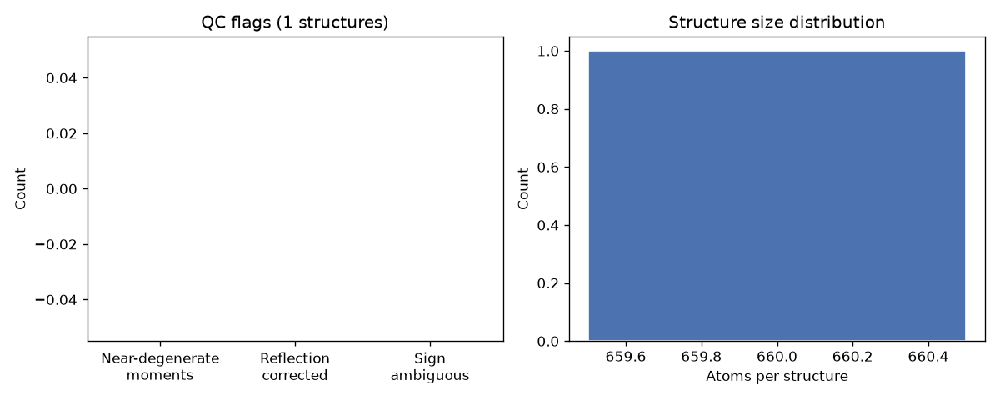

# Batch Run Summary Report

**Run timestamp:** 2026-09-03T20:05:44.705939
**Input directory:** `/home/devin/principle_conversion_project/real_pdb_structures`
**Structures found:** 1
**Succeeded:** 1 / 1

## Environment
- Python 3.11.16
- numpy 2.4.6, scipy 1.17.1, pandas 3.0.5, joblib 1.5.3
- Platform: Linux-6.6.87.2-microsoft-standard-WSL2-x86_64-with-glibc2.43

## Analysis conventions used
- Near-degenerate threshold: 0.02 (Two principal moments flagged if within this fraction of each other.)
- Sign-ambiguous threshold: 0.001 (Flagged when the top-2 largest-projection atoms on any axis are within this relative tolerance -- the sign convention becomes numerically unstable under rotation in this case.)
- Sign convention: For each principal axis, the atom with largest |projection| is forced positive.
- Reflection rule: If the resulting rotation matrix has det(V) < 0 (a reflection, not a proper rotation), axis 2 is flipped to restore det(V) = +1 and preserve molecular chirality.

## QC summary
- Near-degenerate moments flagged: 0 of 1
- Reflection corrections applied: 0 of 1
- Sign-ambiguous (unstable) cases: 0 of 1

